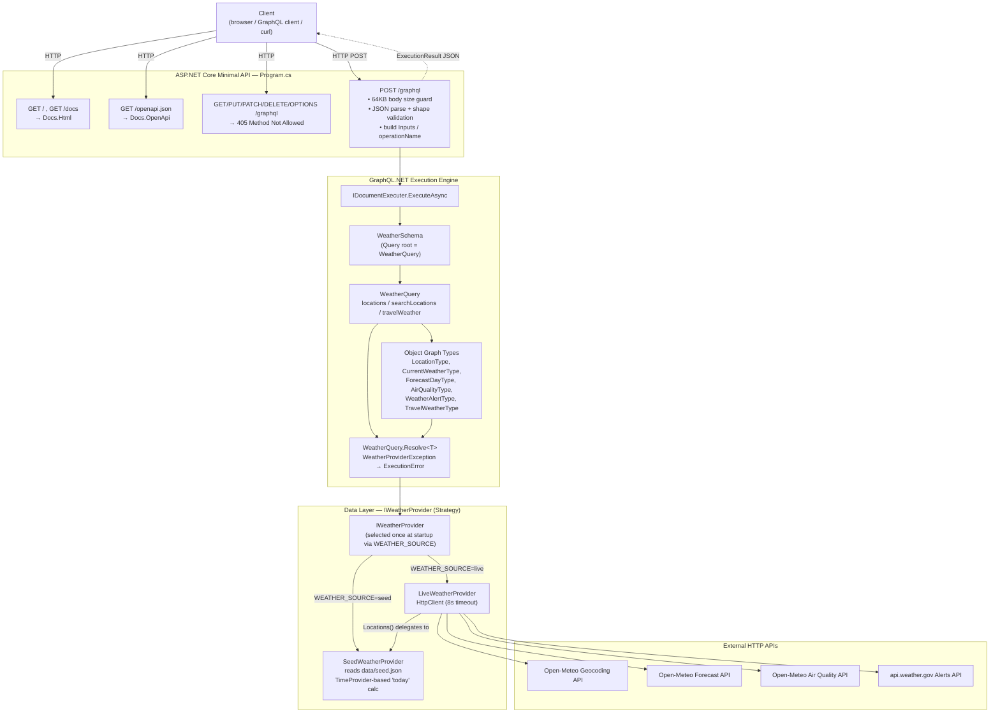
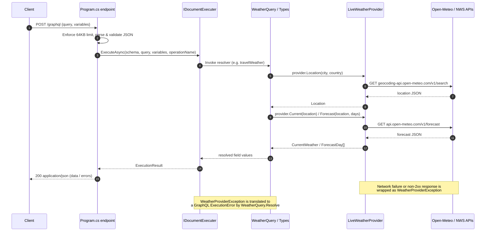

# WeatherApi — Program.cs Analysis & Architecture

This document explains what `WeatherApi/Program.cs` does and how it fits into the overall
architecture of the WeatherApi GraphQL service.

## Overview

`Program.cs` is the **entry point** of a minimal-hosting ASP.NET Core application that exposes a
**GraphQL weather API**. Startup is organized into three phases: configuration & environment setup,
dependency injection (DI) wiring, and HTTP endpoint mapping.

## 1. Configuration & environment setup

```csharp
var source = (Environment.GetEnvironmentVariable("WEATHER_SOURCE") ?? "live").ToLowerInvariant();
if (source is not ("live" or "seed")) throw new InvalidOperationException("WEATHER_SOURCE must be \"live\" or \"seed\"");
var port = Environment.GetEnvironmentVariable("PORT") ?? "4000";
builder.WebHost.UseUrls($"http://0.0.0.0:{port}");
```

- Reads the `WEATHER_SOURCE` environment variable to decide whether weather data comes from a
  **live** external API or a **seed** (static JSON fixture) — useful for local/offline development
  and automated tests. Throws if the value is anything other than `"live"` or `"seed"`.
- Reads `PORT` (defaults to `4000`) and binds Kestrel to `http://0.0.0.0:{port}`.

## 2. Dependency Injection (DI) wiring

| Service | Lifetime | Purpose |
|---|---|---|
| `SeedWeatherProvider` | Singleton | Loads `data/seed.json`, provides canned weather data |
| `HttpClient` | Singleton | 8s timeout; used for outbound calls to live weather APIs |
| `IWeatherProvider` | Singleton | Abstraction selected at startup based on `source` |
| `WeatherQuery` | Singleton | GraphQL root query |
| `WeatherSchema` | Singleton | GraphQL schema |
| `TravelWeatherType`, `LocationType`, `CurrentWeatherType`, `ForecastDayType`, `AirQualityType`, `WeatherAlertType` | Transient | GraphQL object types resolved by GraphQL.NET via DI |
| `IDocumentExecuter` | Singleton | GraphQL.NET's execution engine |
| `GraphQLSerializer` | Singleton | Serializes `ExecutionResult` to JSON |

`IWeatherProvider` resolution:
```csharp
builder.Services.AddSingleton<IWeatherProvider>(services => source == "seed"
	? services.GetRequiredService<SeedWeatherProvider>()
	: new LiveWeatherProvider(services.GetRequiredService<HttpClient>(), services.GetRequiredService<SeedWeatherProvider>()));
```
This is a **Strategy pattern**: the concrete `IWeatherProvider` implementation is swapped purely
through configuration (`WEATHER_SOURCE`), without the GraphQL layer needing any awareness of the
difference. Note that `LiveWeatherProvider` still depends on `SeedWeatherProvider` for the static
`locations` list.

## 3. HTTP endpoints (Minimal APIs)

| Route | Method(s) | Behavior |
|---|---|---|
| `/` , `/docs` | GET | Serves static HTML documentation (`Docs.Html`) |
| `/openapi.json` | GET | Serves an OpenAPI document (`Docs.OpenApi`) |
| `/graphql` | GET, PUT, PATCH, DELETE, OPTIONS | Returns `405` — GraphQL only accepts POST |
| `/graphql` | POST | Executes a GraphQL query |

### `POST /graphql` — request pipeline

1. **Size guard**: rejects requests with `Content-Length > 64 KB` immediately; also streams the body
   manually (8 KB buffer chunks) and aborts with `413` if the accumulated size exceeds the limit —
   avoids buffering arbitrarily large payloads in memory.
2. **JSON parsing**: parses the raw bytes with `JsonDocument.Parse`; returns `400` on invalid JSON.
3. **Shape validation**: ensures the root is an object containing a string `query`, and that
   `variables` (if present) is an object or null, and `operationName` (if present) is a string or
   null. Returns `400 Invalid GraphQL request` otherwise.
4. **Variable deserialization**: converts the `variables` JSON object into GraphQL.NET's `Inputs`
   type via `GraphQLSerializer.Deserialize<Inputs>`.
5. **Execution**: calls `IDocumentExecuter.ExecuteAsync`, supplying the schema, query text,
   variables, operation name, and the request's `CancellationToken` (so client disconnects cancel
   in-flight work).
6. **Response**: serializes the `ExecutionResult` back as `application/json` with status `200`
   (GraphQL convention: even query errors are returned with HTTP 200, errors are encoded in the
   response body's `errors` array).

Finally:
```csharp
public partial class Program;
```
This exposes the implicit `Program` class so integration tests can reference it, e.g. via
`WebApplicationFactory<Program>`.

## Supporting components

### `IWeatherProvider` (abstraction)
Defines the contract implemented by both data sources:
- `Locations(ct)`
- `SearchLocations(name, count, ct)`
- `Location(city, country, ct)`
- `Current(location, ct)`
- `Forecast(location, days, ct)`
- `AirQuality(location, ct)`
- `Alerts(location, ct)`

### `SeedWeatherProvider`
- Reads `data/seed.json` into `SeedRecord[]` at construction.
- Uses `TimeProvider` (injectable for testing) to compute "today" per location's timezone via
  `TimeZoneInfo.ConvertTime`.
- Serves canned `Current`, `Forecast`, `AirQuality`, and `Alerts` data, offsetting dates relative to
  "today".
- Throws `WeatherProviderException` for ambiguous or missing city lookups.

### `LiveWeatherProvider`
- Calls external HTTP APIs via the injected `HttpClient`:
  - Open-Meteo **Geocoding API** — `Geocode()` → resolves city name to `Location` (lat/long, timezone).
  - Open-Meteo **Forecast API** — `Current()` / `Forecast()` → temperature, weather code, wind speed.
  - Open-Meteo **Air Quality API** (implied by `AirUrl`) — `AirQuality()`.
  - `api.weather.gov` **Alerts API** — `Alerts()` (requires custom `User-Agent` and
	`Accept: application/geo+json` headers).
- Wraps network failures (`HttpRequestException`, cancellation-without-client-cancel) and non-success
  HTTP status codes into `WeatherProviderException`, keeping transport failures translated into a
  single domain exception type.
- Delegates `Locations()` to `SeedWeatherProvider` (the live API has no "list all locations" concept).

### `WeatherSchema` / `WeatherQuery` (GraphQL schema)
- `WeatherSchema` : `Schema` — sets `Query = WeatherQuery` instance resolved via DI.
- `WeatherQuery` : `ObjectGraphType` — defines root fields:
  - `locations` — list of all known `Location`s.
  - `searchLocations(name, count = 5)` — fuzzy search; validates `count` is between 1 and 10.
  - `travelWeather(city, country)` — resolves a single `Location` and exposes nested weather data.
- `WeatherQuery.Resolve<T>` is a shared helper that converts `WeatherProviderException` into GraphQL
  `ExecutionError`, used by all resolvers (including nested type resolvers) so provider code stays
  transport/GraphQL-agnostic.

### GraphQL object types
| Type | Backing model | Fields |
|---|---|---|
| `TravelWeatherType` | `Location` | `location`, `current`, `forecast(days)`, `airQuality`, `alerts` |
| `LocationType` | `Location` | `name`, `country`, `timezone`, `region`, `latitude`, `longitude` |
| `CurrentWeatherType` | `CurrentWeather` | `temperatureC`, `condition`, `windSpeedKmh` |
| `ForecastDayType` | `ForecastDay` | `date`, `minTemperatureC`, `maxTemperatureC`, `condition` |
| `AirQualityType` | `AirQuality` | `aqi`, `category` |
| `WeatherAlertType` | `WeatherAlert` | `title`, `severity`, `startsAt`, `endsAt` |

## Architecture diagram

### Component diagram (Mermaid)



### Request sequence — `POST /graphql` (live source)



### Legacy ASCII view (for plain-text viewers)

```
						 ┌─────────────────────────────┐
						 │          Client             │
						 │ (browser / GraphQL client)  │
						 └───────────────┬──────────────┘
										 │ HTTP
				 ┌───────────────────────┼───────────────────────┐
				 │                       │                       │
		   GET / , /docs           GET /openapi.json        POST /graphql
				 │                       │                       │
				 ▼                       ▼                       ▼
		┌────────────────┐     ┌──────────────────┐   ┌─────────────────────────┐
		│   Docs.Html     │     │   Docs.OpenApi    │   │  Program.cs endpoint    │
		└────────────────┘     └──────────────────┘   │  - size limit (64KB)    │
														│  - JSON parse/validate  │
														│  - build Inputs/vars    │
														└───────────┬─────────────┘
																	│
																	▼
													 ┌───────────────────────────┐
													 │     IDocumentExecuter      │
													 │   (GraphQL.NET engine)     │
													 └─────────────┬─────────────┘
																	│ executes against
																	▼
													 ┌───────────────────────────┐
													 │       WeatherSchema        │
													 │  Query root: WeatherQuery  │
													 └─────────────┬─────────────┘
																	│ resolvers call
																	▼
													 ┌───────────────────────────┐
													 │      IWeatherProvider      │  <-- DI-selected
													 │ (interface abstraction)    │      at startup
													 └──────┬──────────────┬──────┘
															│              │
									  WEATHER_SOURCE=seed   │              │  WEATHER_SOURCE=live
															▼              ▼
										 ┌───────────────────────┐   ┌─────────────────────────────┐
										 │  SeedWeatherProvider   │   │     LiveWeatherProvider      │
										 │  reads data/seed.json  │   │  uses HttpClient to call:    │
										 │  (also used by Live    │   │   - Open-Meteo Geocoding      │
										 │   for static locations)│◄──┤   - Open-Meteo Forecast       │
										 └───────────────────────┘   │   - Open-Meteo Air Quality    │
																	  │   - api.weather.gov Alerts    │
																	  └─────────────────────────────┘

GraphQL Types (ObjectGraphType, DI-registered, map domain models -> schema fields):
  LocationType, CurrentWeatherType, ForecastDayType, AirQualityType, WeatherAlertType, TravelWeatherType
```

## Key design points

- **Strategy pattern** via `IWeatherProvider` lets the app swap data sources (live vs. seed) purely
  through configuration, without touching the GraphQL layer.
- The GraphQL layer (`WeatherSchema` / `WeatherQuery` / `*Type` classes) is fully decoupled from HTTP
  transport — `Program.cs` implements a manual POST endpoint instead of using a GraphQL middleware
  package, giving tight control over request size limits and error shaping.
- Domain errors (`WeatherProviderException`) are translated into GraphQL `ExecutionError`s at the
  resolver boundary (`WeatherQuery.Resolve`), keeping provider code transport-agnostic.
- Request body size enforcement is done twice: once via `Content-Length` header check, and once by
  tracking bytes read during manual streaming — this guards against clients that omit or lie about
  `Content-Length`.
